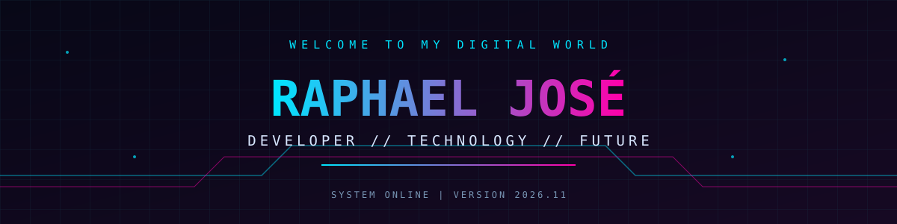

<div align="center">




<br/>


</div>

---

<h2 align="center">⚡ ABOUT ME</h2>

```bash
┌──(raphael㉿cyberworld)-[~]
└─$ whoami

  NAME     : Raphael José
  ROLE     : Developer in progress
  PASSION  : Technology & Programming
  MINDSET  : Learn / Build / Evolve
  STATUS   : ONLINE
```

<div align="center">

*"The future is written in code."*

</div>

---

<h2 align="center">💻 TECH ARSENAL</h2>

<div align="center">


</div>

---

<h2 align="center">📡 GITHUB ANALYTICS</h2>

<div align="center">


</div>

---

<h2 align="center">🌐 ESTABLISH CONNECTION</h2>

<div align="center">

<a href="https://www.instagram.com/raphael_b.taylor/">

</a>

<a href="https://www.linkedin.com/in/raphael-jose-b08091165/">

</a>

<a href="https://twitter.com/taylor_raphael">

</a>

<a href="mailto:raphaeltaylor60@gmail.com">

</a>

<a href="https://www.facebook.com/raphael.taylor.966">

</a>

</div>

---

<div align="center">

```text
╔══════════════════════════════════════╗
║          SYSTEM OPERATIONAL          ║
║                                      ║
║          USER: RAPHAEL-JOSE          ║
║          ACCESS: GRANTED             ║
║          CONNECTION: SECURE          ║
╚══════════════════════════════════════╝
```

</div>
